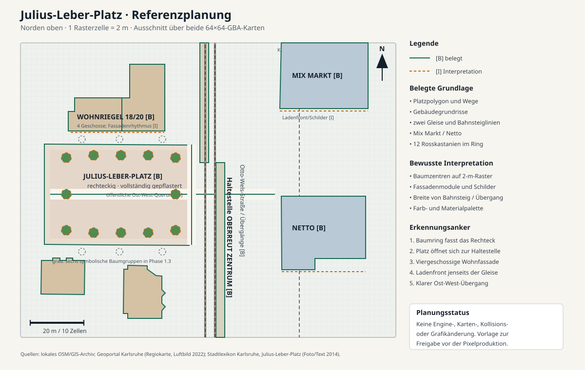

# Julius-Leber-Platz – visuelle Referenzplanung

Status: Freigabevorlage, keine Implementierung. Norden liegt in der Skizze oben; eine GBA-Zelle entspricht 2 × 2 Metern.

## Quellen und belastbare Aussagen

- Das lokale, unveränderte GIS-/OSM-Archiv belegt den Platzumriss (Way 4940191), die angrenzenden Gebäude, zwei Tramgleise (Ways 138293860 und 138293880), die versetzten Bahnsteige (Ways 35995211 und 35995212), öffentliche Wege sowie Mix Markt und Netto. Die amtliche Regiokarte und das Luftbild 2022 im [Geoportal Karlsruhe](https://geoportal.karlsruhe.de/stadtplan) bestätigen Ausrichtung, Gebäudegruppen, Trasse und Baumring.
- Das [Stadtlexikon Karlsruhe](https://stadtlexikon.karlsruhe.de/index.php/De:Lexikon:top-1414) beschreibt einen vollständig gepflasterten, rechteckigen Platz von ungefähr Handballfeldgröße, ringsum zwölf Rosskastanien in zwölf Rundbeeten. Das dortige Foto von 2014 zeigt graues Betonpflaster mit dunklen Bändern, geschnittene Hecken, hohe Baumkronen, schlanke Leuchten und helle viergeschossige Wohnfassaden.
- Eine städtische [Bestandsanalyse zum Oberreuter Zentrum](https://web1.karlsruhe.de/ris/oparl/bodies/0001/downloadfiles/00627753.pdf) nennt gegenüber dem Platz Netto, Mix Markt, Bäckerei, Apotheke, Bankfiliale und weitere Dienstleistungen. Die Skizze verortet nur die durch das lokale GIS eindeutig benannten Supermärkte; weitere einzelne Ladenschilder bleiben bis zu einer Fassadenaufnahme Interpretation.
- Der Bericht [„Entwicklung in Oberreut“](https://www.karlsruhe.de/stadt-rathaus/aktuelles/meldungen/entwicklung-in-oberreut) hält fest, dass die geplante Umgestaltung nicht umgesetzt wurde. Die Planung bildet daher den vorhandenen Platz ab, keine Zukunftsvisualisierung.

## Warum Phase 1.3 nicht wie Oberreut wirkt

Der zentrale Kamerablick besteht fast vollständig aus gleichförmigem, hellem Pflaster. Der reale Platz wird dagegen zuerst als gefasstes Rechteck wahrgenommen: zwölf große Baumkronen, Rundbeete und Hecken erzeugen einen grünen Rand. Phase 1.3 zeigt nur sechs symbolische Baumgruppen außerhalb oder am Rand typischer Sichtfenster; die belegte Ringwirkung fehlt.

Die nördliche Bebauung erscheint als flache, generische weiße Spielfassade. Vor Ort sind viergeschossige Wohnriegel mit dunklen Walm-/Satteldächern, vorspringenden Treppenhausachsen, regelmäßigem Fenster- und Balkonrhythmus sowie Hecken prägend. Die aktuelle geringe Höhe und der gleichmäßige Modulrhythmus verlieren diese Silhouette.

Die Tramkante ist als zwei Schienenstreifen lesbar, aber nicht als Zentrumshaltestelle: versetzte Bahnsteige, taktile Kanten, Mast-/Leuchtenrhythmus, Wartebereich und die räumliche Öffnung des Platzes nach Osten fehlen oder sind zu abstrakt. Jenseits der Trasse fehlt die kommerzielle Gegenkante aus Mix Markt, Netto und kleinteiligen Ladenfronten. Auch die breite Ost-West-Querung und die südwestlichen/nördlichen Zugänge verschwinden im einheitlichen Pflaster.

## Priorität: maximal fünf visuelle Änderungen

1. **Zwölfteiligen Baum- und Rundbeetring herstellen.** Große, über mehrere Metatiles laufende Rosskastanienkronen, runde eingefasste Beete und niedrige Hecken müssen das Platzrechteck in jedem relevanten Kamerablick rahmen.
2. **Platzfläche gliedern.** Kühles graues Betonpflaster, dunkle Querbänder und klar gezeichnete Rand-/Wegefelder sollen die rechteckige Form und die Ost-West-Achse zeigen, ohne die belegte Geometrie oder Kollision zu ändern.
3. **Wohnriegel als viergeschossige Oberreuter Silhouette zeichnen.** Dunkle Dächer, helle Putzflächen, vertikale Treppenhausachsen, Balkone, Sockel und Hecken erhalten einen asymmetrischen, ortstypischen Rhythmus.
4. **Haltestelle als östliche Platzkante lesbar machen.** Zwei Gleise, versetzte Bahnsteige, helle/taktile Kanten, schlanke Masten, Haltestellenschild und Wartezone werden als zusammenhängendes Ensemble gestaltet.
5. **Gewerbliche Gegenkante zeigen.** Mix-Markt- und Netto-Farbakzente sowie eine kleinteilige Schaufenster-/Vordachzone geben dem Blick über die Trasse einen eindeutigen Oberreut-Anker; weitere Geschäftsnamen erst nach aktueller Fassadenprüfung.

## Grafischer Umsetzungsweg

Die Pixelgrafik sollte außerhalb des Generators als handgezeichneter Tileset-Entwurf entstehen. Empfohlen ist **Aseprite oder LibreSprite** mit einem festen 16-Farben-Master, 8×8-Hardware-Tiles und 16×16-Metatiles. Zuerst werden vier kleine Motivblätter erstellt: Baum/Rundbeet, Platzpflaster/Wegekanten, Wohnfassade/Dach und Haltestelle/Ladenfront. Für jedes Blatt werden Nord-/Süd-/Ost-/West-Kanten, Innenflächen und Übergänge bewusst gepixelt; ein 240×160-Mock-up prüft Lesbarkeit und Wiedererkennbarkeit.

Der Python-Generator übernimmt danach nur reproduzierbare Platzierung, Palettenzuordnung und Export. Er zeichnet keine Fassaden oder Vegetation mehr aus Ellipsen und Rechtecken. Eigene PNG-Quellen und eine Metatile-Spezifikation bleiben im öffentlichen Overlay; GIS-Geometrie, Kollisionen und private Engine bleiben unverändert. Vor der Produktion werden Baumzellen, Fassadenhöhe und Ladenbeschriftung anhand der Skizze freigegeben.
